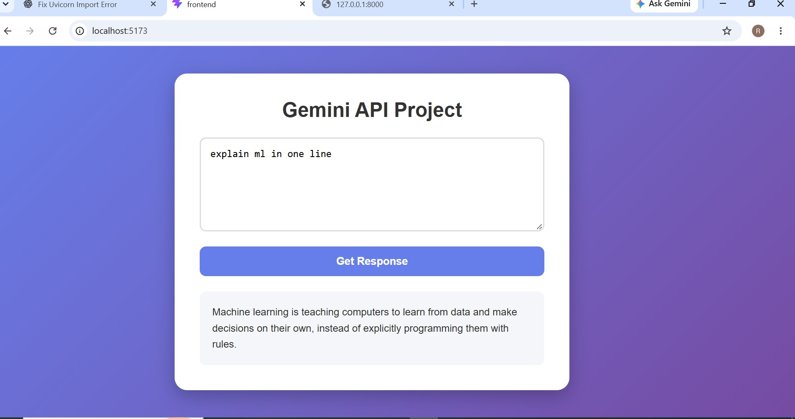
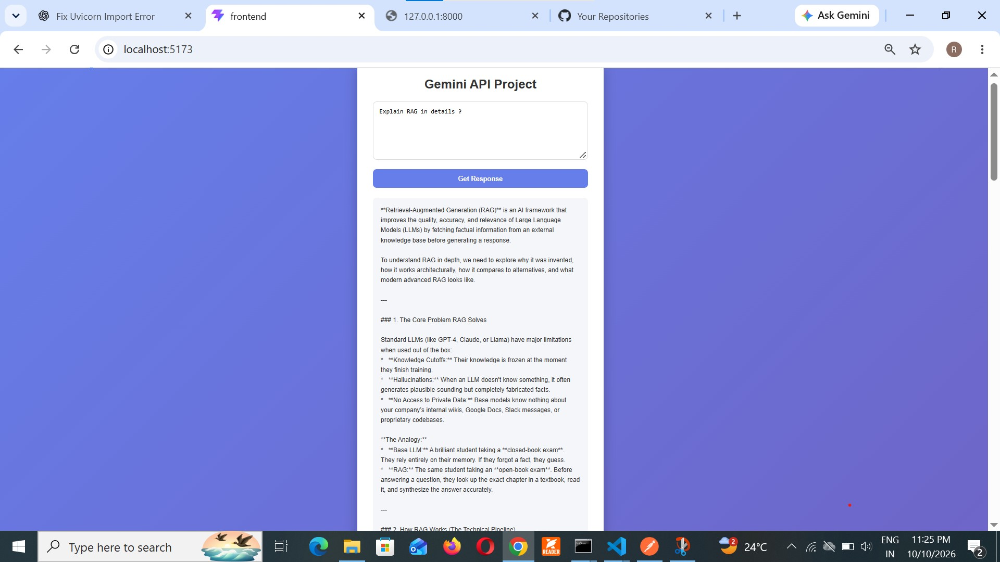
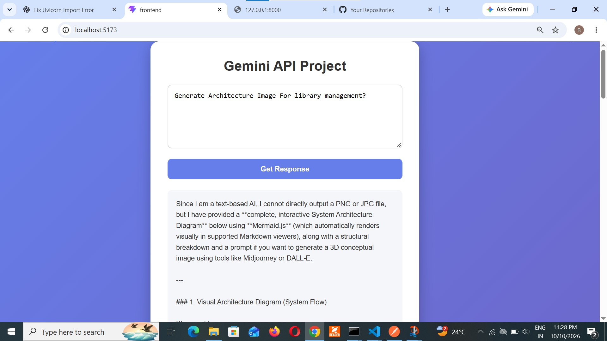

# 🤖 Gemini API Project

A simple AI-powered web application that allows users to enter prompts and receive intelligent responses using an AI API. The project uses a React frontend and a FastAPI backend.

## 🚀 Features

- User-friendly interface
- Enter custom prompts
- Generate AI responses
- Display responses directly on the webpage
- React-based frontend
- FastAPI backend integration
- Responsive UI design

## 🛠️ Tech Stack

- **Frontend:** React, Vite, JavaScript, CSS
- **Backend:** Python, FastAPI, Uvicorn
- **AI Integration:** Gemini API or the AI provider configured in the backend
- **API Communication:** HTTP requests

## 📁 Project Structure

```text
Full Stack App/
├── frontend/
│   ├── src/
│   ├── package.json
│   └── ...
└── backend/
    ├── app/
    │   └── main.py
    ├── requirements.txt
    └── ...
```

*The actual structure may differ depending on your project files.*

## ⚙️ Installation and Setup

### 1. Clone the Repository

```bash
git clone YOUR_GITHUB_REPOSITORY_URL
cd "Full Stack App"
```

Replace `YOUR_GITHUB_REPOSITORY_URL` with your repository URL.

### 2. Set Up the Backend

```bash
cd backend
python -m venv venv
```

Activate the virtual environment on Windows:

```powershell
.\venv\Scripts\Activate.ps1
```

Install dependencies:

```bash
pip install fastapi "uvicorn[standard]"
```

Install any additional packages required by your backend code.

### 3. Start the Backend Server

If `main.py` is inside the `app` folder:

```bash
python -m uvicorn app.main:app --reload --port 8000
```

If `main.py` is directly inside the `backend` folder:

```bash
python -m uvicorn main:app --reload --port 8000
```

Open the API documentation:

http://127.0.0.1:8000/docs

### 4. Set Up the Frontend

Open a new terminal:

```bash
cd frontend
npm install
npm run dev
```

Open the local URL displayed by Vite, usually:

http://localhost:5173

## 🔑 API Configuration

- Configure the AI API key on the backend.
- Store secrets in environment variables or a local `.env` file.
- Never upload API keys or passwords to GitHub.
- Ensure the frontend API endpoint matches the backend route.
- Configure CORS if the frontend and backend run on different origins.

## 🖥️ Application Workflow

1. Open the web application.
2. Enter a prompt in the text area.
3. Click **Get Response**.
4. The frontend sends the prompt to the backend.
5. The backend requests a response from the configured AI provider.
6. The generated response appears on the webpage.

## 📸 Project Screenshots

### 1. Application Interface



### 2. Prompt and Response



### 3. Backend API / Output



## 🔮 Future Enhancements

- Chat history
- Loading indicators
- Better error handling
- Markdown-formatted responses
- Improved mobile responsiveness
- Deployment to a cloud platform

## 👩‍💻 Author

**Rutuja Dabhade**

Artificial Intelligence and Data Science Student

## 📄 License

This project is available for educational and learning purposes. Add a suitable open-source license if you plan to distribute it publicly.
